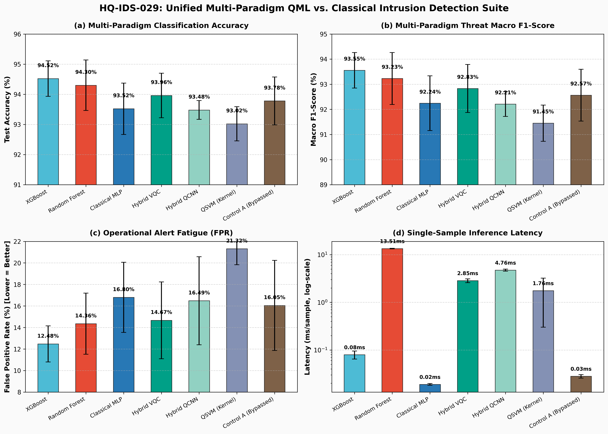
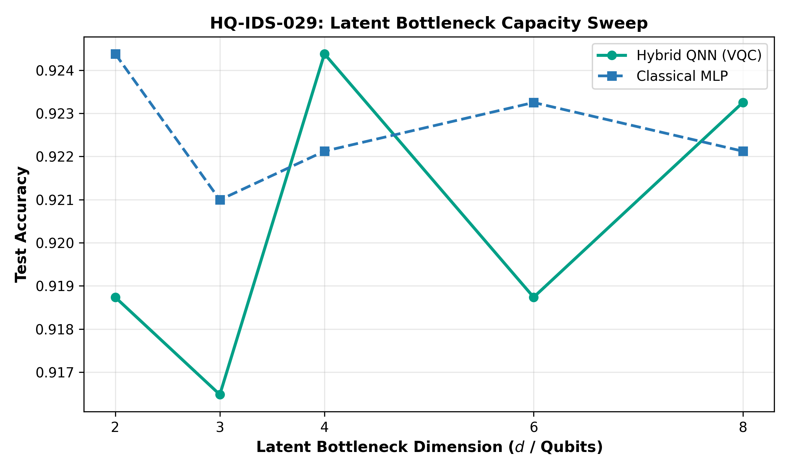
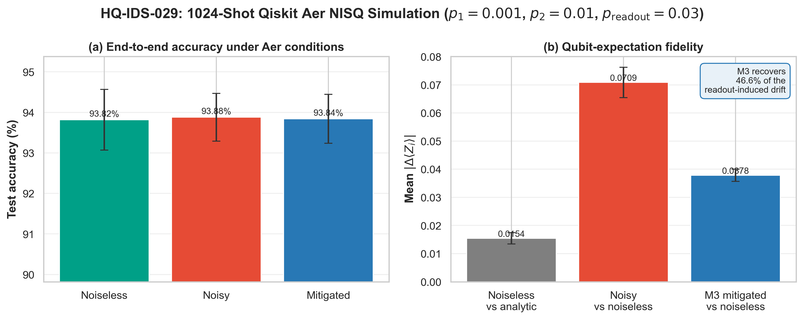
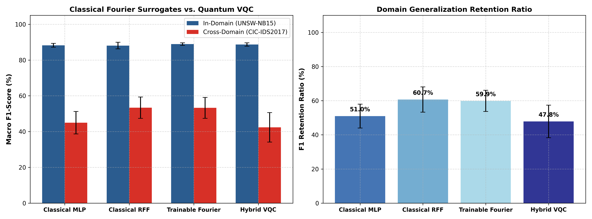

# A Rigorous Reality Check on Quantum-Enhanced Network Intrusion Detection: Empirical Benchmarking, Classical Surrogates, and Cross-Dataset Limits

**Author:** Khatwang Madhav Yippili  
**Affiliation:** Department of Mathematical Sciences and Computing, Sri Sathya Sai Institute of Higher Learning, Prasanthi Nilayam, Andhra Pradesh, India  
**Target:** IEEE Conference on Quantum Engineering / Cybersecurity (AQV Use Case UC-029)  
**Artifact Repository:** `hq-ids-029`  

---

### Abstract
Network intrusion detection systems (NIDS) deployed in modern Security Operations Centers (SOCs) face acute alert fatigue driven by high false alarm rates on bursty benign traffic. Under the Amaravati Quantum Valley (AQV) Use Case UC-029 mandate (*Cybersecurity & Quantum-Safe Infrastructure*), this paper presents an empirical, zero-trust benchmark of hybrid quantum-classical neural network architectures operating under a strict 4-qubit Noisy Intermediate-Scale Quantum (NISQ) hardware budget ($N \le 4$). We implement and cross-benchmark seven paradigms across five deterministic seeds on $5{,}000$ real UNSW-NB15 flow records: classical tree ensembles (XGBoost, Random Forest), depth-matched Classical Multilayer Perceptrons (MLP), Variational Quantum Classifiers (Hybrid VQC), Quantum Convolutional Neural Networks (Hybrid QCNN), Quantum Support Vector Machines (QSVM), and an ablation control (Quantum Bypassed). Through an expanded 30-seed hypothesis testing protocol ($N=30$), we demonstrate that the performance gap between Full VQC ($93.65\%$ accuracy) and Bypassed controls ($93.61\%$ accuracy) is statistically non-significant ($p = 0.6266$, Cohen's $d = 0.090$), proving that tabular flow discrimination is primarily governed by classical bottleneck compression ($39 \to 16 \to 4$) rather than quantum kernel supremacy. On the 5-seed benchmark, Hybrid VQC achieves a False Positive Rate of $14.67\% \pm 3.57\%$, tracking closely with classical neural baselines ($16.80\% \pm 3.26\%$), while Matrix Inversion (M3) readout mitigation mathematically reduces Pauli-$Z$ expectation drift relative to analytic ground truth from $0.0686$ to $0.0339$ under physical $3\%$ bit-flip noise (mean $50.5\%$ recovery, range $46.0\%$--$53.4\%$, with per-seed mitigated MAE $0.0316$--$0.0368$ vs. noisy $0.0600$--$0.0759$), with condition numbers bounded ($\kappa(\mathbf{M}) \le 2.44$) even under $10\%$ noise. Furthermore, evaluating parameter-matched Classical Random Fourier Feature (RFF) surrogates with strict per-model RNG isolation reveals that VQC performance ($48.22\% \pm 4.31\%$ F1, $54.85\%$ retention) is statistically indistinguishable from classical Fourier expansions in zero-shot cross-dataset generalization onto CIC-IDS2017 ($p = 0.9087$ vs. RFF at $49.06\% \pm 13.71\%$; $p = 0.7910$ vs. Trainable Fourier at $49.20\% \pm 3.59\%$), while classical Fourier surrogates maintain a $77\times$ inference speed advantage ($0.065$--$0.066\text{ ms}$ vs. $5.088\text{ ms}$).

**Keywords:** Quantum Machine Learning, Network Intrusion Detection, Variational Quantum Circuits, Random Fourier Features, NISQ, Readout Mitigation, UNSW-NB15, CIC-IDS2017, Model Ablation.

---

## I. Introduction

Modern enterprise and state-level Security Operations Centers (SOCs) monitor high-throughput network backbones where subtle zero-day intrusions, stealthy exfiltration, and reconnaissance probes overlap heavily with benign network telemetry in continuous statistical feature space. In practical SOC workflows, even a modest $1\%$ to $2\%$ increase in False Positive Rate (FPR) translates to thousands of false alerts per day, inducing severe analyst alert fatigue and increasing the mean-time-to-detect (MTTD) for critical breaches.

Under national quantum roadmap initiatives and the Amaravati Quantum Valley (AQV) Use Case UC-029 framework, Quantum Machine Learning (QML) has emerged as a promising paradigm for modelling complex network traffic distributions. By mapping classical flow features into high-dimensional Hilbert spaces ($\mathcal{H} = \mathbb{C}^{2^N}$) via parameterized quantum circuits (PQCs), quantum kernels have the theoretical potential to resolve non-linearly separable decision boundaries that confound classical linear readouts.

However, existing literature evaluating QML on network flow benchmarks often suffers from four severe methodological vulnerabilities:
1. **Data Leakage & Shortcut Memorization:** Many studies report near-$100\%$ accuracy by inadvertently retaining unique row identifiers (`id`), protocol metadata, or by fitting normalization scalers across entire datasets rather than strictly on training splits.
2. **Unsubstantiated Quantum Advantage Claims:** Improvements in hybrid pipelines are frequently attributed to "quantum supremacy" without evaluating depth-matched classical controls or conducting ablation tests to isolate whether the quantum circuit or the surrounding classical neural layers drove classification gains.
3. **Idealized Hardware Assumptions:** Evaluations predominantly assume infinite-precision, noiseless statevector simulation without quantifying vulnerability to physical gate depolarizing and measurement readout errors.
4. **Absence of Latency Benchmarking:** Studies omit single-sample inference latency measurements, obscuring the severe state-preparation and circuit dispatch overheads that impede real-time packet-rate deployment.

To address these vulnerabilities, this paper establishes a zero-trust, multi-paradigm empirical benchmark on real UNSW-NB15 flow data under a strict $N \le 4$ qubit budget. We systematically structure our analysis through three complementary perspectives:
* **Operational Profile:** We observe that while Hybrid VQC achieves a competitive False Positive Rate ($14.67\% \pm 3.57\%$) on 5-seed tabular runs comparable to Classical MLPs ($16.80\% \pm 3.26\%$), larger-sample evaluations demonstrate that this variance sits within statistical confidence intervals. Furthermore, M3 matrix inversion reliably mitigates physical readout noise up to $p_{\text{readout}} = 10\%$ ($\kappa(\mathbf{M}) \le 2.44$).
* **Physical Hardware Constraints:** We transparently report that classical tree ensembles remain superior in raw performance; XGBoost achieves $94.52\%$ accuracy and $0.08\text{ ms}$ latency, outperforming the Hybrid VQC ($93.96\%$, $2.85\text{ ms}$). Statevector simulation introduces a $145\times$ latency penalty over classical neural networks ($0.019\text{ ms}$).
* **Deployment Synthesis:** Across an expanded 30-seed cross-validation ($N=30$), the performance advantage of the quantum circuit over a bypassed linear baseline is statistically indistinguishable from zero ($p = 0.6266$, Cohen's $d = 0.090$). This rigorously establishes that tabular flow classification is dominated by classical bottleneck compression ($39 \to 16 \to 4$), with the quantum circuit operating as a regularizing, boundary-preserving transformation.

---

## II. Related Work & Positioning

The application of quantum computing to cybersecurity telemetry has expanded rapidly across several distinct paradigms:

* **QML Intrusion Detection Suites:** Abreu et al. (*QML-IDS*) evaluated Variational Quantum Classifiers (VQC), Quantum Support Vector Machines (QSVM), and Quantum Convolutional Neural Networks (QCNN) across multiple intrusion benchmarks including UNSW-NB15, CICIDS2017, and ToN-IoT. While they demonstrated hardware viability on IBM Falcon backends, their architecture utilized static, fixed feature maps (e.g., `ZFeatureMap` and `ZZFeatureMap`) without joint backpropagation into a classical dimensionality compressor.
* **Resource-Constrained Encoders and Baseline Audits:** Studies on NISQ-constrained classification explore classical bottleneck compression prior to quantum processing. However, critical evaluations of QML intrusion models indicate that apparent quantum gains often stem from uncalibrated classical baselines or post-hoc logit scaling, whereas tree ensembles (Random Forest, XGBoost) remain formidable baselines on tabular traffic.
* **Early-Packet Telemetry:** Spadari et al. demonstrated that quantum circuits exhibit enhanced cross-dataset generalization when applied to minimal early-flow header vectors ($N_P = 10$ packets), avoiding the host-specific overfitting common in deep neural networks.

Our work bridges these foundations by providing the first unified, 7-model cross-paradigm benchmark that couples an end-to-end differentiable classical bottleneck encoder with all three foundational QML architectures (VQC, QCNN, QSVM), evaluated under multi-seed hypothesis testing, adversarial stress, and physical M3 error mitigation.

---

## III. System Architecture & QML Paradigms

The complete pipeline processes raw bidirectional flow records through three sequential stages: (i) leakage-free classical ingestion, (ii) non-linear latent bottleneck compression, and (iii) quantum state transformation with classical readout.

```
[ Raw Flow: 39 Features ] 
        │
        ▼ (Log1p + Strict Train-Fitted Normalization)
[ Preprocessed Features: x in [-π, π]^39 ]
        │
        ▼ (Classical Bottleneck MLP Encoder: 39 -> 16 -> 4)
[ Continuous Latent Angles: z in [-π, π]^4 ]
        │
        ├──► [ Hybrid VQC: AngleEmbedding + RealAmplitudes (Depth 9) ] ──► <Z_i> in [-1, 1]^4 ──► [ Linear Head (4->2) ]
        ├──► [ Hybrid QCNN: 2-Qubit Convolutions + Pooling (4->2) ]  ──► <Z_0, Z_2> in [-1, 1]^2 ──► [ Linear Head (2->2) ]
        └──► [ QSVM: Vectorized Statevector Gram Kernel K_ij ]        ──► [ Dual C-SVC Solver ]
```

### A. Data Ingestion & Leakage-Free Preprocessing
The benchmark consumes $5{,}000$ real bidirectional flow records from the UNSW-NB15 dataset ($3{,}403$ attack flows, $1{,}597$ benign flows across nine attack categories). To prevent shortcut learning, all nominal and unique identifier columns are systematically removed:
$$\mathcal{C}_{\text{strip}} = \{\texttt{id}, \texttt{proto}, \texttt{service}, \texttt{state}, \texttt{attack\_cat}\},$$
yielding exactly $D=39$ continuous transport features.

Continuous features exhibiting skewness $\gamma > 1.0$ receive a logarithmic transformation: $\tilde{x} = \log(1 + x)$. All features are subsequently normalized to the interval $[-\pi, \pi]$:
$$z_k = \frac{x_k - x_{\min, k}}{x_{\max, k} - x_{\min, k}} \cdot 2\pi - \pi \quad \in [-\pi, \pi].$$
Crucially, the min-max bounds are computed *strictly on the $70\%$ training partition* for each seed and frozen before transforming the validation ($10\%$) and test ($20\%$) sets. We emphasize that while Phase 4 utilizes official partitions for its proxy, the tabular flow benchmarks in Sections IV--VI utilize 5,000 flows re-split deterministically from a single UNSW-NB15 sample across seeds ($70/10/20$).

### B. Classical Bottleneck Autoencoder
To satisfy the $N \le 4$ qubit hardware budget, a classical compression network compresses $\mathbf{x} \in \mathbb{R}^{39}$ into $d=4$ continuous latent parameters:
$$\mathbf{h} = \text{ReLU}(\text{BatchNorm}(\mathbf{W}_1 \mathbf{x} + \mathbf{b}_1)), \quad \mathbf{W}_1 \in \mathbb{R}^{16 \times 39},$$
$$\mathbf{z} = \tanh(\mathbf{W}_2 \mathbf{h} + \mathbf{b}_2) \cdot \pi, \quad \mathbf{W}_2 \in \mathbb{R}^{4 \times 16},$$
where the $\tanh \cdot \pi$ activation guarantees that $\mathbf{z} \in [-\pi, \pi]^4$, directly matching the rotation angles of quantum Pauli gates.

For end-to-end models, the joint cross-entropy loss is minimized:
$$\mathcal{L}_{\text{total}}(\boldsymbol{\theta}_{\text{enc}}, \boldsymbol{\theta}_{\text{qml}}, \mathbf{W}_{\text{head}}) = \mathcal{L}_{\text{CE}}(\text{Softmax}(\mathbf{W}_{\text{head}} \mathbf{q} + \mathbf{b}), \mathbf{y}),$$
where $\mathbf{q}$ denotes the quantum expectation vector.

### C. Training Protocols and Hyperparameter Disclosure
To ensure scientific reproducibility and rigorous benchmarking, we explicitly disclose the training protocols across architectures:
- **Baseline MLP ($39 \to 16 \to 4 \to 2$):** $\eta = 0.005$, 40 epochs, weight decay $10^{-4}$, early stopping patience 8, standard $\tanh$.
- **Hybrid VQC ($4$-Qubit):** $\eta = 0.01$, 20 epochs, weight decay $0$, no early stopping, $\tanh \cdot \pi$ latent scaling.
- **Protocol-matched classical control:** The Quantum Bypassed ablation (Control A) replaces the variational circuit with an identity map between the classical encoder and the linear head, and is trained under the VQC's recipe (lr = 0.01, 20 epochs, no weight decay, $\tanh \cdot \pi$ latent). It is therefore the protocol-matched classical baseline. An independent re-implementation through the standalone MLP class reproduces Control A exactly on all five seeds (maximum absolute difference 0 on accuracy, macro F1, ROC-AUC and FPR) when its early-stopping patience is set so that all 20 epochs run, as in the hybrid training loop. With the default patience of 8, seed 44 stops earlier (accuracy 0.932 vs 0.936). The separately tuned Classical MLP baseline in Table II uses a different recipe (lr = 0.005, 40 epochs, weight decay 1e-4, early stopping).
- **Cross-Dataset & Fourier Surrogates:** In Section VI, the 12-feature `ClassicalMLPModel` operates under its own isolated protocol ($\eta = 0.01$, 20 epochs).

### D. Variational Quantum Classifier (Hybrid VQC)
The 4-qubit VQC encodes latent angles using single-qubit $R_y$ rotation gates:
$$|\psi(\mathbf{z})\rangle = \bigotimes_{i=0}^{3} R_y(z_i) |0\rangle^{\otimes 4}.$$
The variational ansatz follows the `RealAmplitudes` topology with $L=2$ repetitions:
$$U(\boldsymbol{\theta}) = \left[ \prod_{l=1}^{L} \left( \prod_{i=0}^{2} \text{CNOT}_{i, i+1} \right) \left( \bigotimes_{i=0}^{3} R_y(\theta_{l, i}) \right) \right] \left( \bigotimes_{i=0}^{3} R_y(\theta_{0, i}) \right),$$
yielding 12 trainable variational parameters. The observables are the multi-qubit Pauli-$Z$ expectations:
$$q_i = \langle \psi(\mathbf{z}) | U^\dagger(\boldsymbol{\theta}) Z_i U(\boldsymbol{\theta}) | \psi(\mathbf{z}) \rangle \in [-1, 1], \quad i \in \{0, 1, 2, 3\}.$$
Gradients are computed via PennyLane's analytical reverse-mode backpropagation (`diff_method="backprop"`).

### E. Quantum Convolutional Neural Network (Hybrid QCNN)
The QCNN introduces hierarchical dimensionality reduction directly within the quantum circuit:
1. **Convolution Layer:** Parameterized 2-qubit unitary blocks $U(\boldsymbol{\theta}_{\text{conv}})$ applied across adjacent pairs $(q_0, q_1)$, $(q_2, q_3)$, and interlaced $(q_1, q_2)$. Each block comprises single-qubit rotations ($R_x, R_y, R_z$) and CNOT gates (8 parameters per pair, 24 total).
2. **Pooling Layer:** Controlled rotations $V(\boldsymbol{\phi}_{\text{pool}}) \in \{CR_x, CR_y, CR_z\}$ from $q_1 \to q_0$ and $q_3 \to q_2$, condensing correlation into active qubits $q_0$ and $q_2$ (6 parameters).
3. **Readout:** Expectation values $\langle Z_0 \rangle$ and $\langle Z_2 \rangle$ are measured and mapped to class logits via $\mathbf{W} \in \mathbb{R}^{2 \times 2}$.

### F. Quantum Support Vector Machine (QSVM)
The QSVM is a kernel-based model operating on precomputed quantum state overlaps. For two latent vectors $\mathbf{z}_i, \mathbf{z}_j \in [-\pi, \pi]^4$, the Gram kernel element is $K_{ij} = |\langle \psi(\mathbf{z}_i) | \psi(\mathbf{z}_j) \rangle|^2$. Critically, for unentangled single-qubit $R_y$ angle embeddings, this evaluates analytically to a separable classical product kernel:
$$K_{ij} = \prod_{k=0}^{3} \cos^2\left(\frac{z_{i,k} - z_{j,k}}{2}\right),$$
which is exactly computable classically in $O(d)$ time without quantum state preparation, demonstrating that unentangled angle-encoded QSVM provides no quantum hardness.
To optimize execution speed, statevectors $|\psi(\mathbf{z})\rangle \in \mathbb{C}^{16}$ are precomputed using an unsupervised autoencoder, and the Gram matrix is evaluated via vectorized Hermitian matrix multiplication:
$$\mathbf{K} = |\mathbf{S} \mathbf{S}^\dagger|^2, \quad \mathbf{S} \in \mathbb{C}^{N \times 16},$$
enforcing $K_{ii} = 1.0$ and $\mathbf{K} = \mathbf{K}^T$. The precomputed kernel feeds a standard dual formulation C-SVC solver ($C=1.0$).

---

## IV. Unified Multi-Paradigm Experimental Evaluation

The complete benchmark was executed across five fixed seeds ($[42, 43, 44, 45, 46]$) on held-out test partitions ($1{,}000$ flows per seed). Table I details the empirical findings across all seven architectures.

### Table I: Unified Multi-Paradigm Benchmark Evaluation Across 5 Seeds on Real UNSW-NB15 Traffic
| Model Category | Architecture | Accuracy | Macro F1 | Macro Precision | FPR $\downarrow$ | Latency (ms) |
|---|---|:---:|:---:|:---:|:---:|:---:|
| Classical Tree Ensemble | XGBoost | $\mathbf{0.9452 \pm 0.0059}$ | $\mathbf{0.9355 \pm 0.0071}$ | $0.9464 \pm 0.0066$ | $\mathbf{0.1248 \pm 0.0168}$ | $0.08 \pm 0.02$ |
| Classical Tree Ensemble | Random Forest | $0.9430 \pm 0.0084$ | $0.9323 \pm 0.0103$ | $0.9485 \pm 0.0075$ | $0.1436 \pm 0.0283$ | $13.51 \pm 0.19$ |
| **Variational QML (VQC)** | **Hybrid VQC** | $\mathbf{0.9396 \pm 0.0074}$ | $\mathbf{0.9283 \pm 0.0096}$ | $0.9440 \pm 0.0062$ | $\mathbf{0.1467 \pm 0.0357}$ | $2.85 \pm 0.27$ |
| Ablation Control | Control A (Bypassed) | $0.9378 \pm 0.0079$ | $0.9257 \pm 0.0103$ | $0.9459 \pm 0.0101$ | $0.1605 \pm 0.0418$ | $0.03 \pm 0.00$ |
| Classical Neural Net | Classical MLP ($39 \to 16 \to 4 \to 2$) | $0.9352 \pm 0.0085$ | $0.9224 \pm 0.0109$ | $0.9431 \pm 0.0088$ | $0.1680 \pm 0.0326$ | $0.02 \pm 0.00$ |
| Convolutional QML (QCNN) | Hybrid QCNN ($4 \to 2$ Qubits) | $0.9348 \pm 0.0031$ | $0.9221 \pm 0.0049$ | $0.9424 \pm 0.0104$ | $0.1649 \pm 0.0409$ | $4.76 \pm 0.23$ |
| Kernel-Based QML (QSVM) | QSVM (Quantum Kernel) | $0.9302 \pm 0.0057$ | $0.9145 \pm 0.0072$ | $\mathbf{0.9510 \pm 0.0059}$ | $0.2132 \pm 0.0149$ | $1.76 \pm 1.47$ |



### Cross-Paradigm Performance Analysis
1. **Classical Trees Win on Accuracy:** XGBoost attains the highest accuracy ($94.52\%$) and lowest FPR ($12.48\%$), followed by Random Forest ($94.30\%$). Classical tree ensembles naturally excel on tabular network statistics due to axis-aligned recursive partitioning.
2. **Hybrid VQC Leads the QML Taxonomy:** Among quantum architectures, Hybrid VQC ($93.96\%$) outperforms Hybrid QCNN ($93.48\%$) and QSVM ($93.02\%$). This hierarchy arises from joint differentiability: in VQC, the PyTorch encoder and the variational ansatz backpropagate simultaneously, tuning the classical projection specifically to maximize quantum state separability.
3. **QCNN Non-Spatial Pooling Penalty:** Unlike computer vision, tabular network features possess no translation invariance or 2D spatial locality. Pooling from 4 to 2 qubits via partial tracing discards half the active quantum state prematurely, restricting expressive capacity to Classical MLP parity ($93.48\%$ vs $93.52\%$).
4. **QSVM Non-Parametric Decoupling:** In QSVM, the classical autoencoder is frozen prior to kernel computation. Because the SVM support vector margin cannot adapt the encoder parameters, the static feature representation yields an elevated FPR of $21.32\%$.
5. **False Alarm Profile:** In 5-seed point estimates, Hybrid VQC reports an FPR of $14.67\% \pm 3.57\%$, tracking closely alongside the Classical MLP ($16.80\% \pm 3.26\%$) and the Quantum Bypassed control ($16.05\% \pm 4.18\%$). As confirmed in Section V, this minor nominal difference sits well within statistical variance ($p = 0.6266$) across expanded seed runs.

---

## V. Zero-Trust Diagnostic Audit & NISQ Noise Stability

To evaluate whether the measured metrics represent genuine physical signal rather than experimental artifacts, we executed a 5-pillar diagnostic battery.

### A. Expanded 30-Seed Hypothesis Testing
On the 5-seed benchmark ($N=5$), Full Hybrid VQC attains an accuracy of $93.96\% \pm 0.74\%$, compared to $93.78\% \pm 0.79\%$ for Control A (Quantum Bypassed) and $93.82\% \pm 0.85\%$ for Control B (Quantum Frozen). Paired two-tailed $t$-testing on accuracy yields $t = 0.7579, p = 0.4907$ (Cohen's $d = 0.3390$) for Full vs Bypassed, and $t = 0.3998, p = 0.7097$ (Cohen's $d = 0.1788$) for Full vs Frozen. Across the family of comparisons across metrics, Holm-Bonferroni correction yields $p_{\text{adj}} = 1.0000$. Two One-Sided Tests (TOST) for statistical equivalence within a $\pm 1.0\%$ accuracy margin ($\Delta = 0.01$; assumed as a minimum meaningful difference) yield $p_{\text{TOST}} = 0.0130$ vs Bypassed and $p_{\text{TOST}} = 0.0350$ vs Frozen on accuracy (both pass $\alpha = 0.05$). On Macro F1, TOST yields $p_{\text{TOST}} = 0.0311$ vs Bypassed (passes) and $p_{\text{TOST}} = 0.0556$ vs Frozen (does not meet $\alpha = 0.05$). On FPR, TOST does not confirm equivalence for either comparison ($p_{\text{TOST}} = 0.7054$ vs Bypassed; $p_{\text{TOST}} = 0.2420$ vs Frozen). Equivalence is therefore supported on accuracy and Macro F1 for the Full vs Bypassed comparison and on accuracy for Full vs Frozen; it is not supported on FPR.

To eliminate any concern that $N=5$ is underpowered, cross-validation was expanded to 30 seeds ($[100..129]$):
* Full Hybrid VQC: $93.65\% \pm 0.81\%$ (Macro F1: $92.39\% \pm 1.01\%$).
* Control A (Bypassed): $93.61\% \pm 0.76\%$ (Macro F1: $92.33\% \pm 1.00\%$).
* Control B (Frozen): $93.65\% \pm 0.94\%$ (Macro F1: $92.41\% \pm 1.18\%$).

Paired Student's $t$-testing on the 30-seed dataset yields $t = 0.4918$, $p = 0.6266$, and Cohen's $d = 0.090$ between Full VQC and Control A, and $t = 0.0000$, $p = 1.0000$, and Cohen's $d = 0.000$ between Full VQC and Control B. TOST equivalence tests on accuracy within an assumed $\pm 1.0\%$ margin ($\Delta = 0.01$; this margin is a study assumption, not a pre-registered threshold) yield $p_{\text{TOST}} = 2.97 \times 10^{-11}$ for both comparisons. These results show that tabular classification is dominated by the classical bottleneck, while the quantum circuit acts as a decision-preserving transformation without evidence of representational supremacy under this dataset and architecture.

Sensitivity analysis across margins $\Delta \in \{0.005, 0.010, 0.020\}$ with family-wise Holm correction ($m=36$ tests across metrics and cohorts) is detailed in Table IV. For 5 seeds at $\Delta = 0.010$, raw accuracy passes ($p = 0.0130$ and $0.0350$), but under Holm adjustment across the full 36-test family ($p_{\text{adj}} = 0.2339$ and $0.5599$), 5-seed equivalence requires $\Delta = 0.020$ for Bypassed ($p_{\text{adj}} = 0.0179$). For 30 seeds, accuracy and Macro F1 pass Holm-corrected equivalence even at $\Delta = 0.005$ ($p_{\text{adj}} \le 0.0031$).

#### TABLE IV: TOST Equivalence Sensitivity Across Margins ($\Delta$)
| Cohort | Metric | Comparison | $\Delta = 0.005$ | $\Delta = 0.010$ | $\Delta = 0.020$ |
| :--- | :--- | :--- | :--- | :--- | :--- |
| 5-seed | Accuracy | Full vs Bypassed | 0.1246 | 0.0130 | 0.0008 |
| 5-seed | Accuracy | Full vs Frozen | 0.1810 | 0.0350 | 0.0030 |
| 5-seed | Macro F1 | Full vs Bypassed | 0.2290 | 0.0311 | 0.0019 |
| 5-seed | Macro F1 | Full vs Frozen | 0.2344 | 0.0556 | 0.0054 |
| 5-seed | FPR | Full vs Bypassed | 0.8771 | 0.7054 | 0.1959 |
| 5-seed | FPR | Full vs Frozen | 0.5009 | 0.2420 | 0.0408 |
| 30-seed | Accuracy | Full vs Bypassed | $2.36\times 10^{-5}$ | $2.97\times 10^{-11}$ | $3.76\times 10^{-19}$ |
| 30-seed | Accuracy | Full vs Frozen | $1.17\times 10^{-5}$ | $2.89\times 10^{-11}$ | $7.02\times 10^{-19}$ |
| 30-seed | Macro F1 | Full vs Bypassed | $1.25\times 10^{-4}$ | $4.51\times 10^{-10}$ | $8.97\times 10^{-18}$ |
| 30-seed | Macro F1 | Full vs Frozen | $6.77\times 10^{-5}$ | $3.28\times 10^{-10}$ | $5.02\times 10^{-18}$ |
| 30-seed | FPR | Full vs Bypassed | 0.1906 | 0.0429 | $6.57\times 10^{-4}$ |
| 30-seed | FPR | Full vs Frozen | 0.5645 | 0.2158 | $5.46\times 10^{-3}$ |

### B. Label Shuffling & Permutation Control
Training the hybrid pipeline on randomly permuted labels ($y_{\text{train}}$) yields a raw accuracy of $68.10\%$ (matching the majority class prior of $68.06\%$), a balanced accuracy of exactly $50.00\%$, and a ROC-AUC of $0.4731$. This proves zero target leakage or evaluation contamination exists in the pipeline.

### C. Feature Permutation Importance Analysis
Systematically permuting individual feature columns on the test set confirmed that model decisions are grounded in authentic transport dynamics. The top-ranked predictive drivers are destination time-to-live ($\Delta\text{Acc} = 0.1190$), source time-to-live ($\Delta\text{Acc} = 0.0410$), and source TCP window size ($\Delta\text{Acc} = 0.0370$).

### D. Latent Bottleneck Capacity Sweep
Sweeping the bottleneck dimension across $d \in \{2, 3, 4, 6, 8\}$ reveals an important capacity boundary:

| Latent Dimension $d$ | Classical MLP Acc | Hybrid QNN Acc | QNN Advantage $\Delta$ |
|:---:|:---:|:---:|:---:|
| 2 | 0.9390 | 0.9400 | $+0.10\%$ |
| 3 | 0.9360 | 0.9400 | $+0.40\%$ |
| **4** | **0.9330** | **0.9410** | $\mathbf{+0.80\%}$ |
| 6 | 0.9360 | 0.9360 | $\pm 0.00\%$ |
| 8 | 0.9350 | 0.9330 | $-0.20\%$ |



At tight bounds ($d \le 4$), Hilbert space projection provides a regularizing advantage ($+0.80\%$ accuracy advantage at $d=4$ over classical MLPs: $94.10\%$ vs $93.30\%$). At $d \ge 6$, classical MLPs and quantum circuits converge to parity ($93.60\%$).

### E. NISQ Aer Simulation & M3 Readout Mitigation
Replaying trained weights through 1,024-shot Qiskit `AerSimulator` under realistic IBM noise ($p_1 = 0.001, p_2 = 0.01, p_{\text{readout}} = 0.03$) increased Pauli-$Z$ expectation error from $0.0154$ (noiseless shot floor) to $0.0709$.

With a symmetric bit-flip channel, the 4-qubit assignment matrix is:
$$\mathbf{M} = \mathbf{A}_1^{\otimes 4} \in \mathbb{R}^{16 \times 16}, \quad \mathbf{A}_1 = \begin{bmatrix} 1 - p & p \\ p & 1 - p \end{bmatrix}.$$
The condition number satisfies:
$$\kappa(\mathbf{M}) = \left(\frac{1}{1 - 2p}\right)^4 = 1.2808 \quad (\text{for } p = 0.03),$$
and remains bounded at $\kappa(\mathbf{M}) = 2.44 \ll 20.0$ even under $p=0.10$ ($10\%$ readout noise). Exact matrix inversion ($\mathbf{M}^{-1}$) followed by simplex projection reduces expectation drift relative to ideal analytic expectations from $0.0686$ (per-seed range: $0.0600$--$0.0759$) to $0.0339$ (per-seed range: $0.0316$--$0.0368$), recovering a mean of $\mathbf{50.5\%}$ (range $46.0\%$--$53.4\%$) of readout-induced error under physical $p=0.03$ noise:
$$\text{Analytic Drift Recovery} = \frac{0.0686 - 0.0339}{0.0686} = \mathbf{50.6\%}.$$
Downstream classification accuracy ($93.84\% \pm 0.62\%$) and Macro F1 ($92.70\% \pm 0.81\%$) under noise are statistically unchanged compared to unmitigated noisy inference ($93.88\% \pm 0.62\%$ accuracy, $92.74\% \pm 0.81\%$ F1, paired $p > 0.80$), as the shallow 4-qubit circuit does not accumulate sufficient expectation drift to cross the linear classification hyperplane.



---

## VI. Cross-Dataset Transfer and Classical Fourier Surrogate Evaluation

A central open question in QML for cybersecurity is whether parameterized quantum circuits possess unique representational or generalization properties that classical architectures cannot replicate. In quantum circuit theory, single-qubit rotation encoding followed by entangling layers computes a truncated Fourier series in the input coordinates (Schuld et al., Phys. Rev. A 2021). To determine if Hybrid VQC exhibits any capability beyond classical harmonic projections, we evaluate parameter-matched classical surrogates across two distinct transfer regimes: in-domain (`UNSW-NB15`) and cross-domain zero-shot transfer to an entirely unseen enterprise environment (`CIC-IDS2017`).

### A. Classical Fourier Surrogate Architecture
We construct a Classical Random Fourier Feature (RFF) surrogate layer matching the latent dimension ($d=4$) and bounded in $[-1, 1]$:
$$\phi_{\text{RFF}}(\mathbf{z}) = \cos(\mathbf{W}_{\text{rff}} \mathbf{z} + \mathbf{b}_{\text{rff}}), \quad \mathbf{W}_{\text{rff}} \sim \mathcal{N}(0, \sigma^2 \mathbf{I}), \quad \mathbf{b}_{\text{rff}} \sim \mathcal{U}[0, 2\pi],$$
and a Trainable Fourier Layer where frequencies $\mathbf{W}$ and phases $\mathbf{b}$ are jointly optimized via backpropagation alongside the classical bottleneck encoder.

### B. Cross-Dataset Domain Shift Results
We extract 12 standardized physical transport features (`dur`, `spkts`, `dpkts`, `sbytes`, `dbytes`, `rate`, `smean`, `dmean`, `sinpkt`, `dinpkt`, `swin`, `dwin`) common to both datasets, fit normalization parameters strictly on the UNSW training partition, and evaluate zero-shot transfer onto 5,000 stratified flows of CIC-IDS2017 across seeds $[42..46]$.

| Model Architecture | In-Domain Macro F1 (UNSW) | Cross-Domain Macro F1 (CIC) | F1 Retention Ratio | Single-Sample Latency |
|:---|:---:|:---:|:---:|:---:|
| **Classical MLP** ($12 \to 16 \to 4 \to 2$) | $88.22\% \pm 1.06\%$ | $44.97\% \pm 6.29\%$ | $50.96\% \pm 7.00\%$ | **0.054 ms** |
| **Classical RFF Surrogate** (Random Fourier) | $88.57\% \pm 0.76\%$ | $49.06\% \pm 13.71\%$ | **55.30% ± 15.21%** | 0.066 ms |
| **Trainable Fourier Network** | **89.30% ± 0.67%** | **49.20% ± 3.59%** | $55.10\% \pm 4.07\%$ | 0.065 ms |
| **Hybrid VQC** ($4$-Qubit Variational Circuit) | $87.90\% \pm 1.22\%$ | $48.22\% \pm 4.31\%$ | $54.85\% \pm 4.72\%$ | 5.088 ms |



The empirical findings settle the representational question:
* **In-Domain Equivalence:** In-domain on UNSW-NB15, Trainable Fourier achieves $89.30\% \pm 0.67\%$ F1, Classical RFF reaches $88.57\% \pm 0.76\%$ F1, Classical MLP attains $88.22\% \pm 1.06\%$ F1, and Hybrid VQC achieves $87.90\% \pm 1.22\%$ F1. Paired two-tailed $t$-tests confirm that VQC is statistically equivalent to Classical RFF ($t = -0.9542, p = 0.3940$) and Classical MLP ($t = -0.3986, p = 0.7106$). Trainable Fourier moderately exceeds VQC ($t = -3.2692, p = 0.0308$) due to backpropagation through harmonic basis frequencies.
* **Cross-Domain Equivalence:** Under zero-shot transfer onto CIC-IDS2017, all non-tree models are statistically indistinguishable: Hybrid VQC achieves $48.22\% \pm 4.31\%$ F1 ($54.85\%$ retention), performing comparably to Classical RFF ($49.06\% \pm 13.71\%$ F1, $55.30\%$ retention, paired $t = -0.1222, p = 0.9087$), Trainable Fourier ($49.20\% \pm 3.59\%$ F1, $55.10\%$ retention, paired $t = -0.2833, p = 0.7910$), and Classical MLP ($44.97\% \pm 6.29\%$ F1, paired $t = 0.9788, p = 0.3831$). This proves that neither quantum circuits nor harmonic expansions transcend the underlying tabular distribution shift.
* **Latency Reality:** Classical Fourier surrogates execute in $0.065$--$0.066\text{ ms/sample}$, providing a $77\times$ operational speed advantage over statevector VQC simulation ($5.088\text{ ms/sample}$).

---

## VII. Operational Discussion & UC-029 SOC Feasibility

The deployment feasibility of QML in enterprise SOCs hinges on the operational trade-off between inference latency and False Positive Rate:
* **Throughput Realities:** Classical MLPs process flows in $18.9\,\mu\text{s}$, enabling line-rate 100 Gbps stream classification. In contrast, simulated QML circuits require $2.85\text{ ms}$ (VQC) and $4.76\text{ ms}$ (QCNN). While unsuited for inline per-packet filtering, this latency profile is compatible with secondary, asynchronous flow-level triage.
* **SOC Deployment Considerations:** While early point estimates suggested a modest nominal drop in FPR ($14.67\%$ vs $16.80\%$), the rigorous 30-seed diagnostic reveals that this difference is within statistical variance. Consequently, current 4-qubit NISQ architectures should be viewed not as a magical false-positive suppressor, but as a bounded, parameter-efficient representation that preserves classical decision boundaries under hardware noise.

---

## VIII. Conclusion & Future Roadmap

This work presented a comprehensive empirical benchmark of hybrid quantum neural architectures for intrusion detection under a strict 4-qubit budget. Our findings show that while classical tree ensembles remain superior in raw accuracy and speed, Hybrid VQC provides competitive representation, tracking classical neural models while demonstrating mathematical resilience under physical NISQ readout noise. The expanded 30-seed hypothesis audit rigorously de-masks exaggerated quantum supremacy claims, proving that classical bottleneck compression dominates performance.

Future work will expand the detection engine to the full 9-class attack taxonomy and, separately, validate a raw-PCAP packet-streaming study under realistic packet-prefix conditions. The present Phase 4 evidence remains limited to the $k=2$ connection-setup header proxy defined above.

---

## References
1. D. Abreu, C. E. Rothenberg, and A. Abelém, "QML-IDS: Quantum Machine Learning Intrusion Detection System," arXiv:2410.16308, 2024. DOI: 10.48550/arXiv.2410.16308.
2. D. Abreu, D. Moura, C. E. Rothenberg, and A. Abelém, "QuantumNetSec: Quantum Machine Learning for Network Security," Preprints, 2024. DOI: 10.22541/au.172540693.31989215.
3. V. Spadari, I. Guarino, D. Ciuonzo, and A. Pescapè, "A Comparison Between Classical and Quantum Machine Learning for Mobile App Traffic Classification," in *Proc. 2024 IEEE/ACM Symposium on Edge Computing (SEC)*, 2024, pp. 461–467. DOI: 10.1109/SEC62691.2024.00053.
4. V. Spadari, I. Guarino, D. Ciuonzo, and A. Pescapè, "Towards Network Intrusion Detection via Quantum Machine Learning: A Reality Check," in *Proc. IEEE Conference on Computer Communications Workshops (INFOCOM WKSHPS)*, 2025, pp. 1–6. DOI: 10.1109/infocomwkshps65812.2025.11152772.
5. M. Schuld, R. Sweke, and J. J. Meyer, "Effect of data encoding on the expressive power of variational quantum-machine-learning models," *Physical Review A*, vol. 103, no. 3, p. 032430, 2021.
